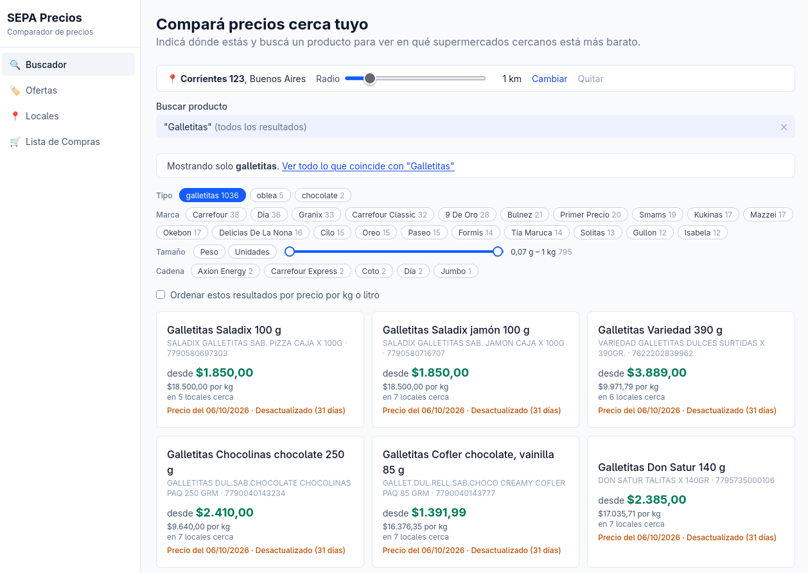

# SEPA Precios

ETL pipeline and web app that compare supermarket prices in AMBA (CABA and
Greater Buenos Aires) using the daily open data from Argentina's
[SEPA price transparency system](https://datos.produccion.gob.ar/dataset/sepa-precios).

> **Status: archived (October 2026).** The data pipeline is complete and runs
> end to end. The shopper app works locally but was never deployed. I stopped
> because SEPA only covers the large chains: to be useful for a real shopping
> list the app would need prices reported by users for small shops, which is
> a different product. See [Project status](#project-status).



## What it does

- Ingests the daily SEPA ZIP: 12-15 M price rows from about 20 chains, of
  which the AMBA scope keeps about 7.6 M rows and 1,834 stores.
- Publishes each day atomically, so the app never reads a half-loaded day.
- Gives every product one identity across chains (valid EAN, or a
  chain-scoped code), with a clean name, type, brand, variant and size voted
  by the chains that sell it.
- Serves search, nearby store prices, daily offers and a shopping list total
  per store, each price with the date it was reported.

## Technical highlights

- **Idempotent ingestion.** SHA-256 per source file, failed runs stay
  retryable, and a rectified day replaces its whole partition in one swap.
- **Reconciliation.** Every source row ends up published, out of scope or
  rejected with a reason; each completed run records counters that satisfy
  explicit equations.
- **Partitioning for retention.** Monthly parents with daily leaves: expired
  days are dropped whole, without row-by-row deletes.
- **Source archive.** The portal overwrites each weekday URL, so every ZIP is
  archived by date and hash and any day can be re-ingested.
- **Measured, not guessed.** A full AMBA day loads in about 12 minutes with a
  1.4 GB memory peak; benchmarks read the numbers from the run logs.
- **Checksummed migrations.** 43 SQL migrations; editing an applied one stops
  the runner.

**Stack:** Python 3.11, pandas, PostgreSQL 16, FastAPI, Pydantic, structlog,
pytest, systemd timer, React 19 + TypeScript, TanStack Query, Leaflet,
Tailwind, Docker Compose, GitHub Actions.

## Known data limits

- Only chains required to report are in SEPA: no small shops or kiosks.
- Fresh products mostly use internal codes and cannot be compared across chains.
- Bank and wallet discounts are not published.

## Architecture

```
Daily ZIP (~300 MB)
  └── ~18 sub-ZIPs (one per chain)
        └── 3 CSVs: comercio.csv | sucursales.csv | productos.csv

          ┌──────────────┐
          │  Download     │  etl/extract/downloader.py
          │  + SHA-256    │  → raw_files (download registry)
          └──────┬───────┘
                 │
          ┌──────▼───────┐
          │   Staging     │  etl/staging/loader.py
          │  (VARCHAR)    │  → stg_comercios, stg_sucursales, stg_productos
          └──────┬───────┘
                 │
          ┌──────▼───────┐
          │   Quality     │  etl/quality/checks.py + reporters.py
          │   Checks      │  8 critical + 7 warnings → rejection_counts
          └──────┬───────┘
                 │
          ┌──────▼───────┐
          │  Transform    │  etl/transform/cleaner.py
          │  + Resolve    │  etl/transform/dimension_resolver.py + fact_builder.py
          └──────┬───────┘
                 │
          ┌──────▼───────┐
          │    Load       │  etl/load/warehouse_loader.py
          │  (Upsert)     │  → dim_*, fact_precios (month → day partitions)
          └──────┬───────┘
                 │
          ┌──────▼───────┐
          │  Publish      │  etl/load/publisher.py
          │  (Atomic)     │  → daily partition swap + carried-forward stores
          └──────────────┘
```

A systemd timer runs the ingestion at 06:30 and 10:30, after the deadlines
chains have to deliver and rectify their files. The FastAPI backend reads
only the latest published day, and the React app talks to the API.

### Database schema (star schema, PostgreSQL 16)

| Layer | Tables |
|-------|--------|
| **Metadata** | `raw_files`, `ingestion_runs` |
| **Staging** | `stg_comercios`, `stg_sucursales`, `stg_productos` |
| **Dimensions** | `dim_comercio`, `dim_sucursal`, `dim_producto`, `dim_provincia`, `dim_fecha` |
| **Fact** | `fact_precios` (monthly parents with daily leaves; grain: product × store × day) |
| **Quality** | `rejection_counts` (every rejection per run, source and reason), `rejected_rows` (bounded sample), `producto_conflictos` (brand and size disagreements between chains), `producto_overrides` (curated corrections, from a versioned seed), `producto_tipo_terminos` and `producto_variante_terminos` (curated type and variant dictionaries, from versioned seeds) |

## Project status

| Phase | Status |
|---|---|
| 0. Validate the premise (source measurements) | Done |
| 1. Snapshot data model and storage cost | Done (source archive is local, not object storage) |
| 2. Correct prices (dates, promotions, reconciliation) | Done |
| 3. Core shopper app | Mostly done: catalog, search, offers, list; missing URL filters, accessibility and persisted lists |
| 4. Deploy | Not started |
| 5. User-reported prices for shops outside SEPA | Not started (reason for archiving) |

## Quick start

Requirements: Python 3.11+, Node.js 18+, Docker and Docker Compose.

```bash
make setup                # create venv + install Python & Node deps
make db                   # start PostgreSQL and apply pending migrations and seeds
make ingest-bounded DATE=2026-03-17 DEV_CHAIN_KEYS=1:1 DEV_MAX_PRODUCT_ROWS=5000
make dev                  # start DB + API + frontend for local development
```

The web app runs at http://localhost:5173 and the API at http://localhost:8000.
`make ingest` downloads today's full ZIP (~300 MB) and runs the whole pipeline.
The checked-in development defaults are enough for a local run; to change the
database credentials, copy `.env.example` to `.env` first.

```bash
make test                 # all tests (integration tests need PostgreSQL)
make lint                 # run linter
make help                 # every available command
```

## Documentation

- [Design](docs/design.md): product decision, what the source showed,
  ingestion invariants, measurements and options decided against.
- [SEPA dataset](docs/sepa-dataset.md): ZIP format, CSV schemas, data rules,
  chains observed and measured source behavior.
- [API](docs/api.md): search, store prices, offers and stores endpoints.
- [Operations](docs/operations.md): migrations, bounded and dated ingestion,
  regional scope, source archive, reconciliation, rejections, telemetry,
  environment variables and the systemd timer.

## References

- [SEPA dataset](https://datos.produccion.gob.ar/dataset/sepa-precios): open data portal
- Resolución 678/2020, Anexo II: official format specification
